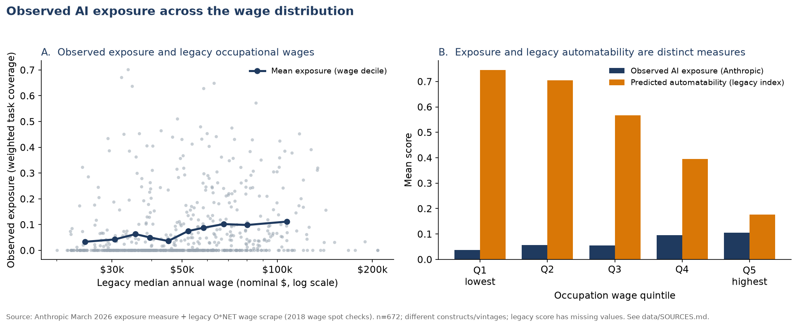

# Observed AI Exposure Across the Wage Distribution

A reproducible empirical note joining **Anthropic's March 2026 observed-exposure measure**
to a **legacy O*NET occupational wage table**, and contrasting it with a legacy
predicted-automatability index. Observed exposure combines theoretical feasibility and
work-related Claude usage with automation and task-time weights; it is not a raw usage share.

**Finding:** In the 672 matched occupations, observed exposure is modestly positively
associated with legacy wages (Spearman ρ = 0.288), while the legacy automatability score
falls across wage quintiles. The exposure quintile means are not strictly monotonic.
These are descriptive comparisons of different constructs and vintages.



## Key findings (n = 672 of 756 exposure occupations)

| Wage quintile | Median legacy wage | Observed exposure | Legacy automatability | Occupations with legacy score |
|---|---:|---:|---:|---:|
| Q1 (lowest) | $28,260 | 0.0378 | 0.7447 | 123 / 135 |
| Q2 | $38,055 | 0.0566 | 0.7041 | 121 / 134 |
| Q3 | $48,270 | 0.0557 | 0.5665 | 124 / 134 |
| Q4 | $62,340 | 0.0949 | 0.3948 | 109 / 134 |
| Q5 (highest) | $91,130 | 0.1051 | 0.1766 | 106 / 135 |

The legacy score is missing for 89 of the matched occupations, so the two score columns
have different denominators. The wage table was already committed upstream in January
2020; checked wage values match May 2018 BLS estimates. A uniform year for all wage rows
has not been established. These are not current wages or an estimate of changes over time.

Separately, **57.4% augmentation / 42.6% automation** describes the named interaction
categories in the **February 2025 Claude.ai release**. That file has no occupation dimension
and is a different vintage from the exposure measure; it cannot describe the 672-occupation
sample or explain the exposure–wage relationship.

> **Coverage:** 84 occupations do not match the legacy wage table. Their mean exposure
> (0.1325) exceeds the matched mean (0.0700), but their missing wages prevent assigning
> a direction to any bias in the wage gradient. See [findings.md](findings.md).

## Correction prepared November 11, 2026

Source verification found that the previous wage CSV ended mid-record after 702 complete
rows, and two exposure values differed from the upstream source. All three inputs now
match a pinned upstream revision byte for byte. The corrected sample is **672**, previously
454; Spearman ρ is **0.288**, previously 0.333. The positive association remains, with
revised magnitudes and coverage. All tables and the figure have been regenerated.
See [CORRECTIONS.md](CORRECTIONS.md) for the before/after accounting.

## Reproduce

Use **CPython 3.12.14**, recorded in `.python-version`, and the complete pinned environment:

```bash
python3.12 -m venv .venv
. .venv/bin/activate
python -m pip install -r requirements.txt
python -m pip check
python analysis.py
python -m unittest discover --start-directory tests --verbose
```

The analysis reads only the committed inputs, verifies their checksums and CSV structure
before computing results, and requires no network access. `results.json` records the
manifest hash and source revision. Tests regenerate the figure and compare every published
numerical result, and reject altered or truncated inputs. A first Matplotlib run may build
its font cache; set `MPLCONFIGDIR` to a writable directory if needed.

If a local input is missing or damaged, `python scripts/restore_inputs.py` explicitly
re-downloads only the pinned, checksum-verified snapshots. It checks all downloads before
replacing any input. Updating the research to a new dataset is a separate, deliberate change.

## Contents and sources

- `analysis.py` — load, clean, join, analyze and plot.
- `data/` — three frozen CSVs, [source/vintage notes](data/SOURCES.md) and [input manifest](data/input_manifest.json).
- `findings.md` — method, findings and limitations.
- `results.json` and `figures/` — regenerated outputs.
- `CORRECTIONS.md` — documented data repair and resulting changes.

The exposure measure comes from [Anthropic's March 2026 methodology](https://www.anthropic.com/research/labor-market-impacts).
The collaboration mix and legacy wage table come from its February 2025 dataset release.
The input data are released by Anthropic under CC-BY; code here is MIT licensed.

## Cite

See [CITATION.cff](CITATION.cff). The working correction is identified as `1.1.0-dev`;
its release date should be set when a corrected release is published.

*Brendan Daly · original note June 2026; correction prepared November 11, 2026.*
